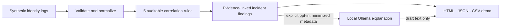

# AI Identity Incident Investigator

**Read-only identity incident correlation, evidence timelines, and optional local-AI triage.**

A portfolio-grade Python MVP for security and IAM operations teams. It ingests normalized identity events from **Entra ID, Active Directory, Okta, NetIQ IDM, and Workday-style synthetic sources**, finds important sequences through transparent rules, and produces an auditable report. The AI never decides whether an event happened: it drafts hypotheses only **after** the evidence rules have run.

> **Important:** The repository ships with fictional identities under `example.invalid`. This is a demo, **not** a validated production detection engine or a live connector to any vendor product. Do not upload confidential or real employee event data to publicly hosted demos.

## Portfolio overview

**[Guided two-minute walkthrough](docs/PORTFOLIO_WALKTHROUGH.md)** · **[Reproducible fixture evaluation](evaluation/README.md)** · **[Source architecture](docs/ARCHITECTURE.md)**

| Engineering result | Verified synthetic-fixture observation |
| --- | --- |
| Identity events processed | **29** |
| Distinct rule-based incident patterns | **5** |
| Expected evidence signatures reproduced | **5 of 5**, zero extra matches |
| Negative-control events with findings | **0 of 4** |
| Privileged access changes or live tenant operations | **None** |

These checks run against deliberately authored synthetic scenarios. **5/5 is not an independently estimated detection precision or security coverage.** LLM explanations are optional and do not influence incident detection.



A practical interview demo: open the HTML report, expand the connector outage and offboarding finding, show their exact source event IDs, then run `python -m evaluation.evaluate` to demonstrate reproducibility. For the limitations and architecture tradeoffs, see the walkthrough.

## Preview

Open [the example investigation report](docs/index.html) in a browser. It is standalone HTML, generated from the included synthetic dataset, and needs no server. You can also try the optional Streamlit UI to upload a test file, inspect findings and export reports.

**Demo result:** 29 events ingested · 5 patterns found · 5 transparent correlation rules · 22+ automated tests.

## Quick start (no paid API, no dependencies for the CLI)

Requires Python 3.10 or later. From the repository root:

```bash
python -m identity_investigator.cli samples/synthetic_identity_events.csv --out reports
python -m unittest discover -s tests -v
```

Open `reports/incident-report.html` to see a human-readable timeline report. Other outputs are `incident-report.csv` and `incident-report.json`.

Install the command-line entry point if preferred:

```bash
python -m pip install -e .
identity-investigator samples/synthetic_identity_events.json --out reports --format all
```

### Optional interactive UI

```bash
python -m pip install -e ".[ui]"
streamlit run app.py
```

The UI opens with bundled synthetic data, so you can explore findings immediately. You can upload an authorized UTF-8 CSV or JSON file, inspect linked evidence and download reports. It does **not** connect to identity tenants or make any access changes.

### Optional real AI (local Ollama)

The default explanation engine is **rule-based** and does not use an LLM. For a true local model narrative, install [Ollama](https://ollama.com), download a compatible model (for example `ollama pull llama3.2:3b`) and start its local service. Then run:

```bash
python -m identity_investigator.cli samples/synthetic_identity_events.csv --out reports --ai ollama --model llama3.2:3b
```

Or enable **Local Ollama** in the Streamlit UI and click **Generate local AI draft** for a selected finding.

- Ollama is contacted only at `127.0.0.1:11434`, on the machine running the application.
- Only minimized structured patterns, counts, severity and prewritten investigation guidance are sent to the model. **No subjects, event IDs, IPs, actors, or raw log lines** are included in the model prompt.
- An AI narrative is *not* evidence and is never allowed to change an account, role, ticket, configuration or policy.
- If Ollama is unavailable, the CLI logs a warning and still creates deterministic reports.

## Detection logic

| Rule | Evidence needed | Interpretation | Severity |
| --- | --- | --- | --- |
| `CONNECTOR_OUTAGE` | `connector_disabled` followed by ≥3 matching `provisioning_failed` in 60 min | Possible connector failure and downstream impact | High |
| `OFFBOARDING_GAP` | `user_terminated` followed by successful sign-in or privilege grant in 24 hr | Possible deprovisioning/session control gap | High / critical* |
| `AUTH_FAILURE_BURST` | ≥5 failed authentications followed by success in 30 min | Review account and sign-in context | Medium |
| `MFA_PRESSURE` | ≥5 denied MFA events followed by approval in 20 min | Possible push fatigue; verify with user | High |
| `DISABLED_ACCOUNT_SIGNIN` | `account_disabled` followed by successful sign-in within 6 hr | Possible propagation or session gap | High |

\* Critical if a post-termination privilege grant is among the events. Severity indicates **triage priority**, not proven compromise. Confidence reflects strength of the observable sequence, not a statistical probability.

## Supported input

CSV or JSON using a common schema. Vendor-specific exports require a separate normalization step (not yet included). For example:

```json
{
  "event_id": "evt-0001",
  "timestamp": "2026-11-03T08:05:00Z",
  "source": "NetIQ IDM",
  "subject": "SYSTEM",
  "action": "connector_disabled",
  "outcome": "info",
  "resource": "AD Connector",
  "actor": "idm-health",
  "metadata": {"connector": "NETIQ_AD"}
}
```

CSV has the same columns, except use `metadata_json` to hold a JSON object as a string. Sample CSV and JSON files are included. See [input schema details](docs/EVENT_SCHEMA.md).

- UTF-8 only; timestamps must include a timezone (`Z` or a numeric offset).
- Maximum file size: 2 MiB; maximum events: 10,000.
- Duplicate event IDs, invalid metadata, and inconsistent field types are rejected.
- Only six fields are mandatory: `event_id`, `timestamp`, `source`, `subject`, `action`, `outcome`.

## Project architecture

```text
CSV / JSON synthetic events
          |
          v
  Validate + normalize
          |
          v
  Correlation rules  ------> Evidence IDs / timestamps
          |                            |
          v                            v
  Incident findings -------------> HTML / CSV / JSON
          |
          +-- Explicit opt-in --> Local Ollama --> Hypothesis draft
                                  (minimized data only)
```

```text
identity_investigator/
  ingest.py       Strict CSV/JSON parsing and normalization
  models.py       Typed event/incident models and stable IDs
  rules.py        Five explainable correlation rules
  narrative.py    Deterministic fallback + opt-in localhost Ollama
  reporting.py    HTML/JSON/CSV reporting with output escaping
  cli.py          Command-line analysis
app.py            Streamlit UI (optional)
samples/          Fictional CSV and JSON event data
reports/          Generated local artifacts (gitignored)
docs/            Architecture, schema, threat model and static demo
.github/workflows/tests.yml  Tests on Python 3.10, 3.12 and 3.13
```

More: [Architecture](docs/ARCHITECTURE.md) · [Threat model](docs/THREAT_MODEL.md) · [Security policy](SECURITY.md).

## Responsible use and limitations

1. Results indicate **patterns to investigate**, not definitive attacks, root causes or governance violations. Rules intentionally favor transparency over sophisticated scoring.
2. Identity linking currently uses an **exact `subject` match**; cross-system identity mapping and account aliases need a deliberate correlation layer.
3. Event timestamps must already be correctly normalized; ingestion converts all input offsets to UTC.
4. Correlation thresholds are illustrative, not calibrated against a real environment. No baselines, geo/device context, causal reconstruction, or false-positive assessment has been performed.
5. Not suited to unrestricted production uploads: there is no authentication, tenant isolation, encryption-at-rest store, RBAC or retention controller.

**Next engineering milestones:** vendor adapters for *synthetic* sample export formats; a transparent identity-mapping table; optional local embeddings for incident/runbook RAG; improved overlap handling and risk scoring; test-fixture-based evaluation; authenticated, deployed UI for enterprise pilots.

## Portfolio skills demonstrated

Python engineering · identity event normalization · IAM lifecycle controls · rule-based security analytics · incident correlation · evidence-backed reporting · local LLM integration · prompt minimization · security guardrails · unit testing · GitHub Actions.

## License

MIT. See [LICENSE](LICENSE). No affiliation with, endorsement by, or live access to Microsoft, Okta, NetIQ, Workday, SailPoint, or other vendors is claimed.
