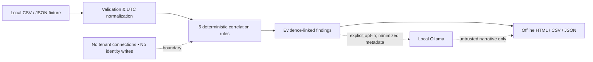

# Two-minute portfolio walkthrough

**Audience:** IAM engineer, security operations analyst, or hiring manager. **Data:** 29 fictional normalized identity events. The tool is read-only; no live tenant integrations.

## Show the working demo

1. Open [the bundled incident report](index.html), or enable GitHub Pages for `main /docs`.
2. Read the **5 findings** summary and expand the **CONNECTOR_OUTAGE** investigation. Explain the causal hypothesis is *only a hypothesis*: one connector-disabled event preceded five downstream provisioning failures sharing the connector ID.
3. Inspect **OFFBOARDING_GAP**. Show how termination, subsequent sign-in, and privileged group access lead to a **critical triage finding** while keeping event IDs available for independent verification.
4. Point out **MFA_PRESSURE** and **DISABLED_ACCOUNT_SIGNIN** as two other sequence patterns across synthetic sources.
5. Run `python -m evaluation.evaluate` and explain why 5/5 exact fixture matches are not an estimate of real-world precision.

## Architecture and trust boundaries

## What the code proves

- **Detection and evidence separated from explanation:** see [rules.py](../identity_investigator/rules.py) and [narrative.py](../identity_investigator/narrative.py).
- **Input controls:** see [ingest.py](../identity_investigator/ingest.py) for bounded parsing and timestamp checks.
- **Output safety:** see [reporting.py](../identity_investigator/reporting.py) for HTML escaping and CSV-formula guards.
- **Reproducible evaluation:** see [fixture evaluation](../evaluation/README.md) and [ground truth](../evaluation/ground_truth.json).
- **Security posture:** see [threat model](THREAT_MODEL.md).

**Known gaps:** exact-subject identity matching, hand-selected rule thresholds, synthetic-only evidence, no independent FP-rate estimation, and no production authentication/authorization. These are conscious MVP limits, not claims of enterprise deployment readiness.

## Discussion question for interviews

*How would you safely add cross-system identity correlation?* I would first introduce a versioned, access-controlled mapping layer with evidence of identifier lineage, rather than guessing identity equality from names. Replay annotated fixtures through the same read-only rules, then measure alert quality before a tenant integration.
